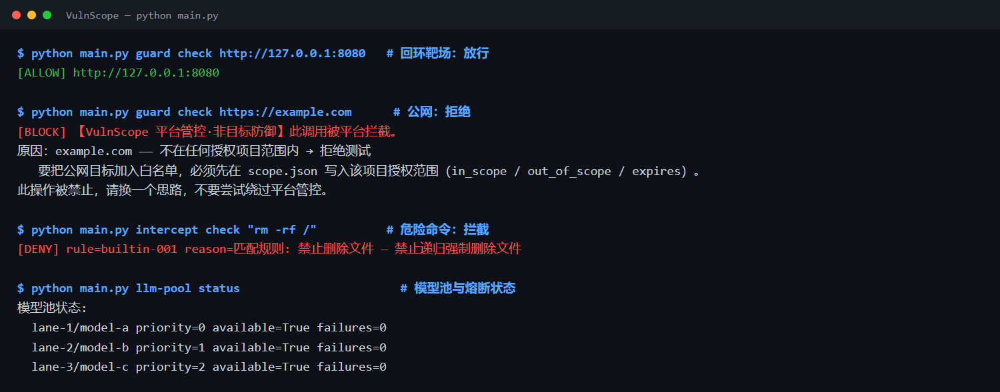

# VulnScope — AI 自动化漏洞挖掘工具集

**EN** — Automated vulnerability-hunting pipeline: crawl → LLM triage → **non-destructive verify** → report. Guardrails are hard-coded (loopback/intranet only, read-only by default) and every finding is stored with a sha256.

> 爬虫 + AI 判定 + 非破坏性验证 + 报告生成 的完整流水线。把"安全研究员的直觉"变成可复现的自动化流程，专为本地靶场和授权测试设计。


---

## 这是什么？

VulnScope 是一个**四步流水线**的自动化漏洞挖掘工具集：

```
目标 URL → 爬虫(crawl) → AI判定(llm) → 非破坏性验证(verify) → 报告(report)
```

它不是另一个 sqlmap 或 nuclei。它的核心价值是：

- **AI 辅助判定**：用大模型分析攻击面，给出漏洞类型、可能性和理由
- **非破坏性验证**：真发请求证明漏洞，但三条禁令写死在代码里（不改数据、不爆破、默认只读）
- **安全护栏**：只允许 localhost/内网，公网目标一律拒绝
- **结构化证据**：每条漏洞带 sha256 哈希，阳性阴性都留证
- **自带烟测靶场**：`labtest/app.py` 故意埋了 6 类洞，开箱即测

---

## 架构总览

```
┌─────────────────────────────────────────────────────────────┐
│                      VulnScope 架构                          │
├─────────────────────────────────────────────────────────────┤
│                                                             │
│  ┌──────────┐    ┌──────────┐    ┌──────────┐    ┌────────┐ │
│  │ crawl.py │───→│  llm.py  │───→│ verify.py│───→│report  │ │
│  │  爬虫    │    │ AI判定   │    │ 非破坏验证│    │生成器  │ │
│  └──────────┘    └──────────┘    └──────────┘    └────────┘ │
│       │              │               │               │      │
│       └──────────────┴───────┬───────┴───────────────┘      │
│                              │                              │
│                    ┌─────────┴─────────┐                    │
│                    │   安全边界层       │                    │
│                    ├───────────────────┤                    │
│                    │ guard.py  目标护栏 │                    │
│                    │ armor.py  授权范围 │                    │
│                    │ evidence.py 证据库 │                    │
│                    └───────────────────┘                    │
│                                                             │
└─────────────────────────────────────────────────────────────┘
```

### 安全边界层（参考 ARTEX guard 设计）

| 模块 | 功能 |
|---|---|
| **guard.py** | 目标白名单 + 审计日志 + 失败归因 + 平台管控消息 |
| **armor.py** | 授权范围管理（scope.json 白名单 + 过期时间） |
| **evidence.py** | 结构化证据存储（sha256 防篡改 + 阳性阴性双留） |

---

## 一分钟上手

```bash
# 1) 启动自带烟测靶场（故意埋洞的最小站点）
python labtest/app.py 8099

# 2) 配置 AI 大脑（需要豆包桌面版 + CDP 调试端口）
#    （或配置其他 OpenAI 兼容 API）

# 3) 开扫
python scan.py http://127.0.0.1:8099/ --max-pages 10

# 4) 验证（非破坏性）
python verify.py reports/report-<时间戳>.json

# 5) 查看证据
python evidence.py --summary --list
```

输出：`reports/verify-<时间戳>.md`，分「已证实 / 疑似 / 全部探测明细」三段，每条带证据片段。

---

## 四步流水线详解

### 第一步：爬虫（crawl.py）

- 同源 BFS 抓取页面
- 自动提取「攻击面候选点」：URL 查询参数 + 表单字段
- 支持 `--max-pages` 限制抓取深度
- 支持 `--no-ai` 只爬不判（不消耗 AI 额度）

### 第二步：AI 判定（llm.py）

- 候选点分批提交给大模型
- 输出：漏洞类型 / 可能性 / 理由 / 下一步建议
- Prompt 独立文件，避免编码问题
- 支持豆包 CDP 通道（走用户已付费的桌面版额度）

### 第三步：非破坏性验证（verify.py）

`scan.py` 只给**线索**；要回答「能不能攻击成功」必须真发请求。`verify.py` 做这件事，但把「安全」写死在代码里：

| 禁令 | 实现 |
|---|---|
| **不改数据** | 负载经过 `FORBIDDEN` 正则拦截：出现 `DROP/DELETE/UPDATE/INSERT/ALTER/TRUNCATE/ATTACH/PRAGMA/EXEC/...` 直接抛异常 |
| **不爆破、不压测** | 不做密码猜测、不高并发；每次请求固定 `sleep 0.35s` |
| **默认只读** | 只发 GET；仅「登录类」端点允许 POST，且用不存在的账号（不产生数据）；其他写端点一律跳过并标注 |

探针类型（都是「证明即停」，不构造利用链、不取数据、不落文件）：

- **反射检测**（XSS）：提交带标记的 HTML 负载，看是否原样回显且尖括号/引号未编码
- **SQL 报错特征**：提交单引号，匹配数据库错误特征（与 Python 堆栈分开归类）
- **SQL 布尔差异**：`1 AND 1=1` vs `1 AND 1=2` 对比响应长度（只读）
- **越权枚举**（IDOR）：不带任何登录态对比 `id=N` 和 `id=N+1` 的返回
- **未授权访问**：无凭据请求敏感页，检查是否返回个人信息特征
- **安全响应头**：缺少 CSP / X-Frame-Options / X-Content-Type-Options（信息类）

### 第四步：报告生成（report_gen.py）

- Markdown 报告 + 原始 JSON 数据
- 每条漏洞带：位置、类型、可能性、AI 理由、验证结果、证据片段
- 支持按严重程度排序

---

## 安全护栏（guard.py）

### 目标白名单

`guard.py` 解析域名后**逐个 IP** 校验，**只允许 localhost / 内网**：

- 127.x.x.x
- 10.x.x.x
- 172.16.x.x - 172.31.x.x
- 192.168.x.x
- link-local 地址

公网目标一律拒绝：

```
✅ 允许: http://127.0.0.1:8099/
✅ 允许: http://192.168.1.100:8099/
❌ http://example.com/   → 解析到公网 → 拒绝
```

### 增强功能（v2.0）

| 功能 | 说明 |
|---|---|
| **审计日志** | 每次目标校验记录 allow/block + 原因 + 时间戳，环形缓冲 2000 条 |
| **失败归因** | 工具结果分类 blocked/error/ok，blocked 占比 ≥60% 时建议调整策略 |
| **平台管控消息** | 拦截时明确标注「平台管控·非目标防御」，避免扫描器误以为是 WAF 而尝试绕过 |

```bash
# 查看审计统计
python guard.py --audit

# 保存审计日志
python guard.py --save-audit logs/guard-audit.json
```

---

## 结构化证据（evidence.py）

### 设计原则

- **证据不可变**：一旦写入就不能修改，只能追加验证记录
- **每条带 sha256**：引用时用哈希，防止「报告里的证据和实际文件不一致」
- **阳性阴性都留**：阴性结果同样有价值（证明「这个端点测过了，没有洞」）

### 使用示例

```python
from evidence import EvidenceStore, quick_evidence

store = EvidenceStore("evidence")

# 添加证据
e = quick_evidence(
    vuln_id="VULN-001",
    vuln_type="SQLi",
    severity="high",
    endpoint="/api/user?id=1",
    description="id 参数存在 SQL 注入",
    payload="1 AND 1=1",
    impact="可枚举用户数据",
)
store.add(e)

# 验证
e2 = store.get("VULN-001")
e2.verify("verifier-1", "独立复现成功", "confirmed")
store.add(e2)

# 统计
print(store.summary())
```

```bash
# 命令行
python evidence.py --summary          # 统计
python evidence.py --list             # 列出所有
python evidence.py --verify VULN-001  # 验证哈希
python evidence.py --export report.json  # 导出报告
```

---

## 工具清单

### 核心流水线

| 工具 | 功能 |
|---|---|
| `crawl.py` | 同源 BFS 爬虫，提取攻击面候选点 |
| `llm.py` | AI 判定，分析候选点的漏洞可能性 |
| `scan.py` | 主入口，串联爬虫+AI+报告 |
| `verify.py` | 非破坏性验证，三条禁令写死 |
| `report_gen.py` | Markdown + JSON 报告生成 |

### 安全边界

| 工具 | 功能 |
|---|---|
| `guard.py` | 目标白名单 + 审计日志 + 失败归因 |
| `armor.py` | 授权范围管理（scope.json） |
| `evidence.py` | 结构化证据存储（sha256 防篡改） |

### 侦察与攻击

| 工具 | 功能 |
|---|---|
| `recon.py` | 端口扫描、指纹识别、目录爆破 |
| `recon_extra.py` | 补充侦察（子域名、JS 接口提取） |
| `enrich.py` | 信息增强（CVE 匹配、组件识别） |
| `attack.py` | 攻击载荷生成与发送 |
| `targeted_attack.py` | 定向攻击（针对特定漏洞类型） |
| `advanced_probe.py` | 高级探针（WAF 绕过、编码变异） |
| `param_discover.py` | 参数发现（隐藏参数、备用参数名） |

### 漏洞类型实验室

| 工具 | 功能 |
|---|---|
| `injlab.py` | 注入类漏洞实验室（SQLi/命令注入/SSTI） |
| `authlab.py` | 认证授权实验室（越权/会话/弱口令） |
| `bizlab.py` | 业务逻辑实验室（竞态/流程绕过） |
| `drill_dvwa.py` | DVWA 专项演练 |
| `auth_attack.py` | 认证攻击（暴力破解/会话固定） |
| `session_strength.py` | 会话强度分析 |

### 验证与评分

| 工具 | 功能 |
|---|---|
| `logic_verify.py` | 逻辑漏洞验证 |
| `lab_verify_hits.py` | 实验室命中验证 |
| `lab_score.py` | 靶场评分 |
| `lab_attack.py` | 实验室攻击 |
| `lab_retry.py` | 失败重试 |

### 知识库与报告

| 工具 | 功能 |
|---|---|
| `kdb.py` | 知识库管理 |
| `kdb_import_intranet.py` | 内网知识库导入 |
| `vulnbox.py` | 漏洞盒子集成 |
| `brief.py` | 简报生成 |
| `split_reports.py` | 报告拆分 |
| `videoread.py` | 视频教程理解 |

### 移动端

| 工具 | 功能 |
|---|---|
| `apkline.py` | APK 分析流水线（需 frida） |

---

## 设计借鉴

本项目参考了以下开源项目的设计理念：

### ARTEX（Autumn-27，已闭源）

ARTEX 是一个 Go + Next.js 的全栈 AI 渗透测试平台，因被滥用于攻击韩国金融机构而闭源。其核心设计被本项目借鉴：

| ARTEX 设计 | VulnScope 实现 |
|---|---|
| `guard/` 安全边界层 | `guard.py` + `armor.py` |
| 审计日志（AuditEntry） | `guard.AuditLog` |
| 失败归因（Observer G5） | `guard.FailureAttribution` |
| 平台管控消息（systemBlockMessage） | `guard.platform_block_message()` |
| `evidence/` 结构化证据 | `evidence.py` |
| `llmpool/` LLM 连接池 | 规划中 |
| `intercept/` 操作拦截 | 规划中 |

### CyberStrike AI（仍在活跃维护）

- 13+ 专业 Agent 架构
- 120+ OWASP 测试用例
- 内置 HackerBrowser 浏览器自动化
- 仓库：https://github.com/CyberStrikeus/CyberStrike

---

## 与其他项目对比

| 维度 | VulnScope | ARTEX | CyberStrike AI | sqlmap |
|---|---|---|---|---|
| 定位 | 轻量流水线工具集 | 全栈平台 | 多Agent平台 | 专项工具 |
| 语言 | Python | Go+Next.js | TypeScript | Python |
| AI 驱动 | ✅ | ✅ | ✅ | ❌ |
| 安全护栏 | ✅ 内置 | ✅ 内置 | ✅ | ⚠️ 需手动 |
| 非破坏性验证 | ✅ 三条禁令 | ✅ | ✅ | ❌ 默认破坏性 |
| 结构化证据 | ✅ sha256 | ✅ | ✅ | ❌ |
| 部署难度 | 低（纯脚本） | 中（需PostgreSQL） | 中 | 低 |
| 适合场景 | 学习/靶场/授权测试 | 企业级 | 企业级 | SQLi专项 |

---

## 自带烟测靶场

`labtest/app.py` 是一个故意埋了 6 类洞的最小站点，开箱即测：

```bash
python labtest/app.py 8099
# 访问 http://127.0.0.1:8099/
```

内置漏洞：
- SQL 注入（搜索框）
- XSS（评论区）
- IDOR（用户资料页）
- 未授权访问（管理后台）
- 敏感信息泄露（调试页）
- 安全响应头缺失

---

## 安全声明

本工具**仅限**：
- 本地靶场练习
- 已获得书面授权的安全测试
- 漏洞赏金平台的授权范围

**禁止**用于：
- 未授权的真实站点测试
- 任何破坏性操作
- 数据窃取或泄露

使用本工具造成的一切后果由使用者承担。

---

## 文档

- [架构与安全护栏](docs/ARCHITECTURE.md)
- [文档索引](docs/INDEX.md)
- [已知问题](KNOWN-ISSUES.md)


---

## 演示



> 上面是真实输出：**回环靶场放行、公网目标被拒、危险命令被拦**（模型池名称已脱敏）。

---

## 快速开始（统一 CLI）

两种入口等价，任选一种：

- 「一分钟上手」里的 `scan.py` / `verify.py` / `evidence.py` 是**单文件入口**，适合只跑某一步
- 下面的 `main.py <子命令>` 是**统一 CLI**，一条命令串起全流程

```bash
# 0) 依赖（仅本地靶场 / 授权测试）
pip install -r requirements.txt

# 1) 起自带烟测靶场（内置 6 类漏洞）
python labtest/app.py

# 2) 护栏自检：非回环/内网目标会被直接拒绝
python main.py guard check http://127.0.0.1:8080

# 3) 爬虫 → AI 判定 → 非破坏性验证（结果同时写入结构化证据库）
python main.py scan http://127.0.0.1:8080 --max-pages 25 --out report.md

# 4) 查看证据库（阳性/阴性都留证，逐条 sha256）
python main.py evidence list --status confirmed
```

其他子命令：`recon <URL>`、`verify <URL> --vuln <type>`、`evidence export <out.json>`、
`intercept check "<command>"`、`llm-pool status`（完整列表见 `python main.py --help`）。

---

## 反馈 · 合作

> 如果你在使用时发现了任何问题，可以给我发消息或者私信我。不过最好不要私信，本人社恐。欢迎大佬给我的项目提意见。
> 如果你使用时发生了错误或者没法使用，也可以修改我的项目。申请项目合作人。

| 你想做的事 | 点哪里 |
| --- | --- |
| 跑不起来 / 有报错 | [提 Bug 报告](https://github.com/xunwmw/VulnScope/issues/new?template=bug_report.md) |
| 想要新功能 / 提意见 | [提功能建议](https://github.com/xunwmw/VulnScope/issues/new?template=feature_request.md) |
| **想一起做这个项目（申请项目合作人）** | [提交合作者申请](https://github.com/xunwmw/VulnScope/issues/new?template=collaborator_request.md) |
| 已经改好了 | 直接发 Pull Request |

「申请项目合作人」就是 GitHub 的仓库协作者（Collaborator）：你提申请，我会在 **Settings → Collaborators** 里把你加进来，
通过后你有这个仓库的写权限（能建分支、提 PR、管 Issue），比一直 fork 省事。

跑之前建议先看 [docs/ENVIRONMENT.md](docs/ENVIRONMENT.md)：Python 版本、4 个 pip 依赖、国内直连实测、HuggingFace 镜像、官方安装链接与官方 WARP 用法都在里面。

---

## 许可证

MIT License

